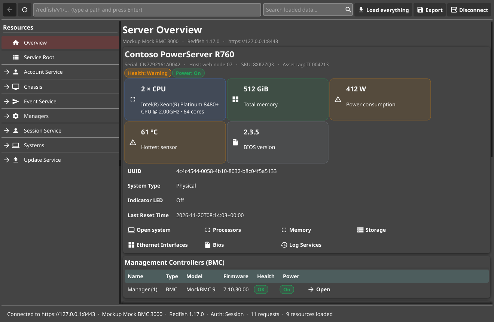
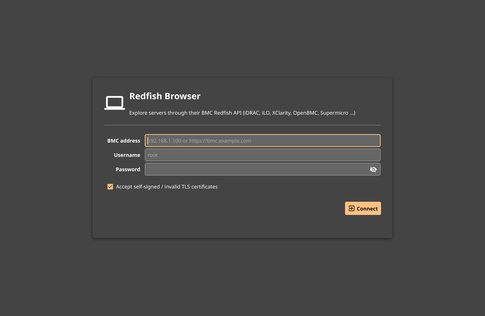
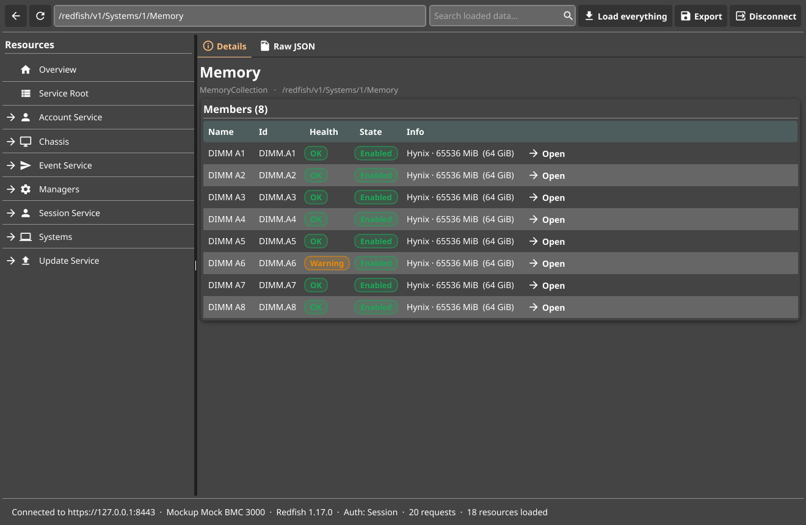
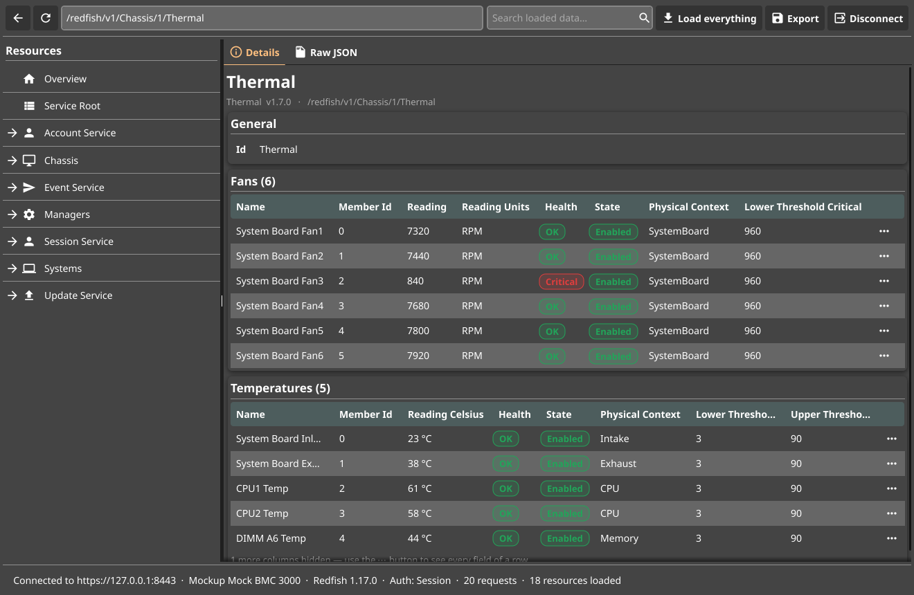
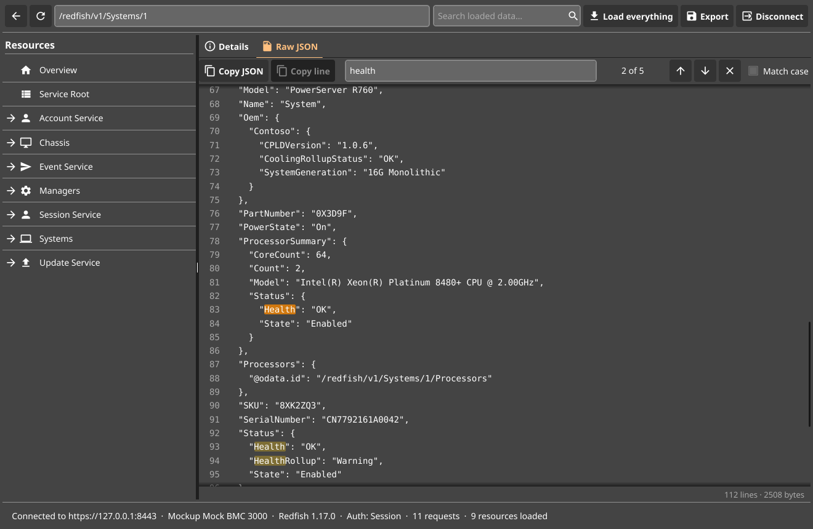

# Redfish Browser

A desktop app for exploring a server's hardware through its BMC's
[Redfish](https://www.dmtf.org/standards/redfish) API. Enter an address, a username and a
password to get a readable dashboard of the machine instead of raw JSON.

It works with any Redfish-compliant BMC: Dell iDRAC, HPE iLO, Lenovo XClarity, Supermicro,
OpenBMC and others. It is written in Go with [Fyne](https://fyne.io) and builds into one
native binary.

> **Read-only by design.** The app only sends `GET` requests, plus the session login and
> logout. It never changes settings or triggers actions on the server.



## Features

- **Overview dashboard**
  - Model, serial number, health and power state.
  - Tiles for CPUs, memory, power draw, the hottest sensor and the BIOS version.
  - Tables of BMCs and chassis, plus temperature gauges, fans and power supplies.
- **Resource tree** covering the whole Redfish service.
  - Branches load when you expand them.
  - Collection members show their real names, such as `DIMM A1`, not just IDs.
- **Readable resource pages**
  - Health and state values appear as colored badges.
  - Nested objects become forms, and arrays of objects become tables. The ⋯ button on a row shows every field of that row.
  - Values have units: GiB, °C, W, RPM, MHz, Mbps and so on.
  - Related resources are clickable links, and the available actions are listed.
  - Collections show every member's name, health, state and a short summary.
- **Raw JSON tab** on every page
  - Line numbers.
  - Find with highlighted matches: <kbd>Ctrl</kbd>+<kbd>F</kbd> opens it, <kbd>Enter</kbd> or ↑/↓ moves between matches, and match case is optional.
  - Copy the whole document or the clicked line.
- **Load everything** crawls the entire service in the background, with a progress indicator.
- **Search** looks through every resource loaded so far, including keys and values.
- **Export** saves everything that has been loaded to a single JSON file.
- **Navigation**: back and refresh buttons, plus a path bar where you can open any `/redfish/v1/...` URI directly.
- **Connection handling**
  - Uses Redfish session tokens and falls back to HTTP Basic auth if sessions aren't available.
  - Can accept self-signed certificates.
  - A **Stop** button cancels a slow or hanging connection attempt.

## Screenshots

| Login | Collections |
|---|---|
|  |  |
| **Sensors as tables** | **Raw JSON with search** |
|  |  |

## Installation

### Requirements

- Go **1.25** or newer.
- A C compiler. Fyne uses CGO for OpenGL.
- Graphics development headers:

| OS | Command |
|---|---|
| Debian / Ubuntu | `sudo apt install gcc libgl1-mesa-dev xorg-dev` |
| Fedora | `sudo dnf install gcc libXcursor-devel libXrandr-devel mesa-libGL-devel libXi-devel libXinerama-devel libXxf86vm-devel` |
| Arch | `sudo pacman -S go gcc libxcursor libxrandr libxinerama libxi mesa libxxf86vm` |
| macOS | `xcode-select --install` |
| Windows | Install [MSYS2](https://www.msys2.org/) with the MinGW-w64 GCC toolchain |

See Fyne's [getting started guide](https://docs.fyne.io/started/) for more details.

### Build

```sh
git clone https://github.com/dinuxlt/redfish_browser.git
cd redfish_browser
./build.sh            # builds ./redfish-browser and ./mockbmc
./redfish-browser
```

A plain `go build -o redfish-browser .` also works when all the headers are installed.

`build.sh` adds a workaround for Linux systems without the `libxxf86vm-dev` package. It links
against the runtime library `libXxf86vm.so.1` instead.

## Usage

1. Start `redfish-browser`.
2. Enter the BMC address, for example `192.168.1.100`, `bmc.example.com:8443` or
   `https://10.0.0.5`. Then enter a username and a password.
3. Leave **Accept self-signed / invalid TLS certificates** checked unless your BMC has a
   trusted certificate. Most BMCs use a self-signed one.
4. Click **Connect**. If the BMC is unreachable, click **Stop** instead of waiting for the
   90-second timeout.

The app remembers the last host and username. It never stores the password.

| Shortcut | Action |
|---|---|
| <kbd>Ctrl</kbd>+<kbd>F</kbd> | Find in the Raw JSON tab, or otherwise search loaded data |
| <kbd>Enter</kbd> (in find box) | Next match |

## Try it without hardware

The repository includes a mock BMC that serves a realistic Redfish tree:

- a system with CPUs, 8 DIMMs, storage, NICs, BIOS and a SEL log
- chassis with thermal and power data
- a manager, accounts, sessions, an update service and an event service

```sh
./mockbmc -addr 127.0.0.1:8443      # HTTPS with a self-signed certificate
./mockbmc -addr 127.0.0.1:8080 -http  # plain HTTP
```

Then connect to `127.0.0.1:8443` with username `admin` and password `admin`.

## How it works

- **Authentication**: the app creates a Redfish session (`X-Auth-Token`) and deletes it on
  disconnect or exit. If the BMC refuses sessions, it uses HTTP Basic auth.
- **Gentle on the BMC**: at most 4 requests run at once, because many BMCs struggle under
  parallel load. Responses are cached, and identical requests that are already running are
  shared instead of being sent twice. The refresh button re-fetches the current page.
- **Crawling**: *Load everything* follows every link from the service root. A large server
  can have thousands of resources, so it may take a few minutes. The crawl stops at 10,000
  resources.

## Project layout

| File | Purpose |
|---|---|
| `main.go` | Entry point |
| `app.go` | Login screen, main window, tree, navigation, search, crawl and export |
| `redfish.go` | Redfish HTTP client: sessions, caching and concurrency limit |
| `model.go` | Link extraction, property ordering, value formatting and units |
| `render.go` | Turns any Redfish resource into forms, tables and link lists |
| `overview.go` | Overview dashboard |
| `widgets.go` | Shared UI pieces: status badges, tiles, tables and cards |
| `jsonview.go` | Raw JSON viewer with search |
| `cmd/mockbmc/` | Mock Redfish server for development and demos |

## Running tests

```sh
go test ./...
```

To regenerate screenshots against the mock (headless, no display needed):

```sh
./mockbmc &
REDFISH_MOCK=127.0.0.1:8443 SHOT_DIR=/tmp/shots go test -run 'TestScreenshots|TestRawFind' .
```
